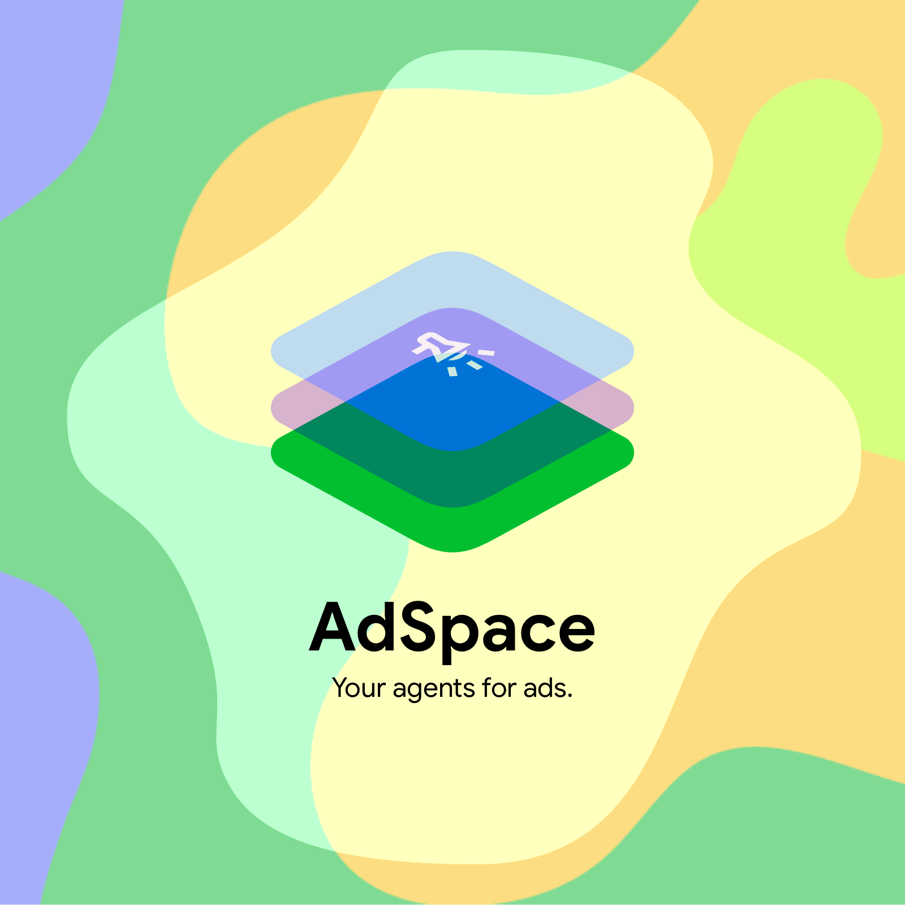

**This is not an officially supported Google product.**



# AdSpace Agent (Rust)

AdSpace Agent is designed to provide a standardized way to integrate an LLM with
Google Ads, YouTube, Google Cloud, and Google Search to form a more
comprehensive campaign and marketing plan for agencies.

This is the Rust port of
[google-marketing-solutions/adspace_agent](https://github.com/google-marketing-solutions/adspace_agent),
built on [adk-rust](https://github.com/zavora-ai/adk-rust) 2.3.0.

[](https://github.com/google-marketing-solutions/adspace_agent/actions/workflows/ci.yml)
[](https://conventionalcommits.org)

## Getting Started

### Prerequisites

- Rust 1.95+ (`rustup`)
- `gcloud auth application-default login` (Vertex AI, Cloud Storage, BigQuery)

### Environment Variables

Create a `.env` file in the root of the project (see
[`.env.sample`](.env.sample) for every option):

```shell
# Gemini via Vertex AI (Application Default Credentials)
GOOGLE_CLOUD_LOCATION=global
GOOGLE_CLOUD_PROJECT=
GOOGLE_GENAI_USE_VERTEXAI=TRUE

# Google API toolsets (OAuth 2.0 "Web application" client)
CLIENT_ID=
CLIENT_SECRET=
PUBLIC_BASE_URL=http://localhost:8000

# Google Ads
GOOGLE_ADS_DEVELOPER_TOKEN=
GOOGLE_ADS_LOGIN_CUSTOMER_ID=

# Optionals:
# MODEL=gemini-3.8-flash
# VIDEO_MODEL=veo-3.1-fast-generate-001
# IMAGE_MODEL=gemini-3.1-flash-image
# ENABLED_TOOLSETS=bid_manager,bigquery,campaign_manager_360,display_video_360,drive,merchant_center_inventories,merchant_center_products,merchant_center_reports,search_ads_360,storage,youtube,google_ads,google_genai
# GOOGLE_ADS_TOOL_FILTER=googleads_customers_google_ads_search,googleads_google_ads_fields_search,googleads_customers_generate_audience_definition,googleads_customers_generate_audience_composition_insights
# SKILLS_BUCKET_NAME=adspace-agent
# LOCAL_SKILLS_DIR=./skills
# SESSION_SERVICE_URI=sqlite:///./sessions.db
# ARTIFACT_SERVICE_URI=gs://adspace-agent
# MEMORY_SERVICE_URI=memory://
```

### Development

Build and run the web server (ADK web UI at `http://localhost:8000/ui/`):

```shell
cargo run -- serve
```

Chat from the terminal instead:

```shell
cargo run -- console
```

Run the quality gates:

```shell
cargo fmt --all -- --check
cargo clippy --all-targets -- -D warnings
cargo test
```

### User authorization (OAuth 2.0)

Google Ads, Campaign Manager 360, Display & Video 360, Drive, YouTube, ... are
called on behalf of the signed-in user, and the credentials belong to the
**chat session** — not to the server:

1. Open the web UI; a session is created.
2. The first time a tool needs Google access it returns
   `status: "AUTH_REQUIRED"` with an authorization link that is bound to that
   session (the OAuth `state` parameter is a signed claim naming the session).
3. The user grants access; Google redirects to
   `${PUBLIC_BASE_URL}/oauth2/callback`, which exchanges the code and writes
   the tokens into the session's state (`CREDENTIALS_CACHE_KEY`, the same key
   the Python agent used).
4. The user tells the agent to continue; the tool reads the token from the
   session state (refreshing it when expired) and calls the API.

Add that redirect URI to the OAuth client in the Google Cloud Console. One
consent covers every enabled toolset (incremental authorization is used when a
new scope is needed). A new session starts without credentials; tokens are
persisted with the session (so they survive restarts with
`SESSION_SERVICE_URI=sqlite://...`) and disappear with it. There is no
server-side token store.

## Exploring Available Tools

```shell
cargo run -- list-tools google-ads
cargo run -- list-tools youtube
cargo run -- list-tools google --api drive --version v3
cargo run -- list-tools all        # every Discovery-based toolset you enabled
```

Tool names are derived from the Google API Discovery documents exactly like
the Python ADK (`drive.files.list` → `drive_files_list`, truncated to 60
characters), so the existing `*_TOOL_FILTER` lists work unchanged.

## Toolsets

| Toolset key | Implementation |
|---|---|
| `google_ads`, `display_video_360`, `drive`, `youtube`, `storage`, `search_ads_360`, `bid_manager`, `merchant_center_*`, `campaign_manager_360` | Discovery-document driven `GoogleApiToolset` (`src/google_api`) with the user's OAuth credentials |
| `campaign_manager_360` (additionally) | `parse_sheet_tool` / `traffic_campaigns_in_cm360_tool` (`src/tools/cm360_trafficking`). The trafficking workflow instructions ship with the toolset itself — no separate skill is needed. |
| `bigquery` | adk-rust `BigQueryToolset` (Application Default Credentials, read-only by default; `BIGQUERY_READ_ONLY=false` to allow DML) |
| `google_genai` | `get_info_about_youtube_video` and `generate_image` through adk-rust's Gemini client (Imagen via `:predict`), `generate_video` (Veo long-running operation) — results are saved as session artifacts |
| always on | Python execution (see below), `list_user_files`, adk-rust's built-in `load_artifacts` and `preload_memory`, adk-rust's progressive skills (`list_skills`, `load_skill`, `load_skill_resource`) plus `reload_skills` |
| Gemini built-ins (`GEMINI_BUILTIN_TOOLS`) | `google_search`, `url_context`, `google_maps` by default (`none` disables). These run server-side inside Gemini, as does the default `gemini_code_execution`. |

### Python data analysis

Model-written Python runs through adk-rust built-ins only; `PYTHON_EXECUTOR`
selects which:

| Value | Tool | Notes |
|---|---|---|
| `gemini` (default) | `gemini_code_execution` | Gemini writes and runs the code server-side (numpy, pandas, matplotlib, scikit-learn, … available). No infrastructure; stateless per turn. |
| `vertex` | `vertex_sandbox_code_execution` | Vertex AI Agent Engine managed sandbox (`VERTEX_SANDBOX_NAME` or `VERTEX_AGENT_ENGINE`). Stateful per session. |
| `docker` | `python_code` | Container-backed CPython (`PYTHON_DOCKER_IMAGE`). Needs a Docker daemon. |
| `monty` | `monty_python_code` | In-process Monty interpreter (Python subset, no third-party packages). Requires `cargo build --features monty`. |

## Configuring Your GCS Bucket for Agent Skills

Custom skills can be loaded from a local directory (`LOCAL_SKILLS_DIR`,
default `./skills`) and/or from a Cloud Storage bucket by setting
`SKILLS_BUCKET_NAME`. The bucket layout is unchanged from the Python agent:

```text
gs://{YOUR_SKILLS_BUCKET_NAME}/
└── skills/
    └── my-skill/
        └── SKILL.md
```

`SKILL.md` carries YAML front matter with a `name` (matching the folder) and a
`description`; the body holds the instructions. Skills are exposed to the model
through progressive disclosure (`list_skills` / `load_skill`) and can be
refreshed at runtime with the `reload_skills` tool.

> [!NOTE]
> The former `cm360-trafficking` skill is no longer a skill: its workflow now
> lives in the CM360 trafficking toolset so there is a single source of truth
> for those actions.

## Deployment

Enable the required APIs:

```shell
gcloud services enable \
  aiplatform.googleapis.com \
  bigquery.googleapis.com \
  cloudbuild.googleapis.com \
  dfareporting.googleapis.com \
  displayvideo.googleapis.com \
  doubleclickbidmanager.googleapis.com \
  drive.googleapis.com \
  googleads.googleapis.com \
  run.googleapis.com \
  merchantapi.googleapis.com \
  searchads360.googleapis.com \
  storage.googleapis.com \
  youtube.googleapis.com
```

### Cloud Run

```shell
gcloud run deploy adspace-agent \
  --source . \
  --region us-central1 \
  --memory 4Gi \
  --cpu 1 \
  --port 8000 \
  --set-env-vars "\
GOOGLE_CLOUD_LOCATION=global,\
GOOGLE_CLOUD_PROJECT={YOUR_GOOGLE_CLOUD_PROJECT},\
GOOGLE_GENAI_USE_VERTEXAI=TRUE,\
GOOGLE_ADS_DEVELOPER_TOKEN={YOUR_GOOGLE_ADS_DEVELOPER_TOKEN},\
GOOGLE_ADS_LOGIN_CUSTOMER_ID={YOUR_GOOGLE_ADS_LOGIN_CUSTOMER_ID},\
CLIENT_ID={YOUR_CLIENT_ID},\
CLIENT_SECRET={YOUR_CLIENT_SECRET},\
PUBLIC_BASE_URL=https://{YOUR_CLOUD_RUN_URL},\
SKILLS_BUCKET_NAME={YOUR_SKILLS_BUCKET_NAME},\
ARTIFACT_SERVICE_URI=gs://{YOUR_ARTIFACT_BUCKET}"
```

The [Dockerfile](Dockerfile) builds a release binary and ships it on a
`debian:bookworm-slim` image — no Python runtime is needed because code
execution happens server-side in Gemini.

## Differences from the Python agent

- Context caching and events compaction are configured through environment
  variables (`CONTEXT_CACHE_*`, `COMPACTION_*`) instead of `App(...)`.
- `bigquery` authenticates with Application Default Credentials rather than the
  end user's OAuth token.
- The operations staged by `parse_sheet_tool` are stored as a versioned session
  artifact (`cm360_payloads.json`) through the configured artifact service
  instead of a hard-coded GCS path.
- Deployment targets Cloud Run; Agent Engine (ReasoningEngine BYOC) can be added
  with adk-rust's `agent-engine` / `gcp-deploy` features.

## Contributing

Want to contribute? [Learn more](CONTRIBUTING.md)
