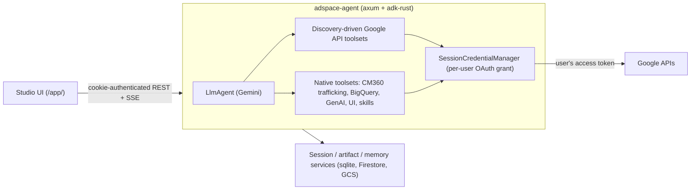

**This is not an officially supported Google product.**


# AdSpace Agent (Rust)

[](https://github.com/google-marketing-solutions/adspace_agent/actions/workflows/ci.yml)
[](https://conventionalcommits.org)

AdSpace Agent gives agencies a single LLM-driven assistant for Google's
marketing stack: it plans, analyses and (where enabled) executes work across
Google Ads, Campaign Manager 360, Display & Video 360, Search Ads 360, Merchant
Center, YouTube, Drive, Cloud Storage and BigQuery, with Google Search, Maps and
Gemini code execution available as built-ins. Every Google API call is made
**as the signed-in user**, with the narrowest OAuth scope the tool needs.

This is the Rust port of
[google-marketing-solutions/adspace_agent](https://github.com/google-marketing-solutions/adspace_agent),
built on [adk-rust](https://github.com/zavora-ai/adk-rust) 2.3.0.

- [How it works](#how-it-works)
- [Getting started](#getting-started)
- [Command line](#command-line)
- [Configuration](#configuration)
- [Authentication and authorization](#authentication-and-authorization)
- [Toolsets](#toolsets)
- [Skills](#skills)
- [Deployment](#deployment)
- [Troubleshooting](#troubleshooting)
- [Differences from the Python agent](#differences-from-the-python-agent)

## How it works



- **One agent, many toolsets.** Most Google APIs are exposed straight from
  their Discovery documents (`src/google_api`): tool names, schemas and scopes
  are derived at start-up, so `drive.files.list` becomes `drive_files_list`
  exactly as in the Python ADK. A few workflows are hand-written where the API
  alone is not enough (CM360 sheet trafficking, BigQuery read-only guard, image
  and video generation).
- **The user's identity, not the server's.** Google data is only ever read or
  written with the signed-in user's OAuth token. The service account's
  Application Default Credentials are used solely for infrastructure: the
  Gemini / Imagen / Veo model backend, Cloud Storage artifacts and skills, and
  the optional Vertex sandbox.
- **Studio UI.** `/app/` is a purpose-built chat UI with Google Sign-In, an
  interactive `adk-ui` canvas (charts, tables, KPI tiles, forms), file uploads,
  usage/cost tracking and a trace view.

## Getting started

### Prerequisites

- Rust 1.99+ (`rustup`).
- On Linux, the system libraries adk-cli links against:
  `sudo apt-get install pkg-config libdbus-1-dev libssl-dev`
  (the Dockerfile and CI install the same packages).
- `gcloud auth application-default login` for the model backend and buckets
  (Vertex AI, Cloud Storage). This identity is **not** used for user data.
- An OAuth 2.0 client of type **Web application** in the Google Cloud Console
  with `${PUBLIC_BASE_URL}/oauth2/callback` (for local development
  `http://localhost:8000/oauth2/callback`) in its authorized redirect URIs.
- For Google Ads: a developer token and, when acting through a manager
  account, its login customer id.

### Configure

Create a `.env` file in the project root ([`.env.sample`](.env.sample) lists
every option with comments):

```shell
# Gemini via Vertex AI (Application Default Credentials)
GOOGLE_CLOUD_LOCATION=global
GOOGLE_CLOUD_PROJECT=
GOOGLE_GENAI_USE_VERTEXAI=TRUE

# Google Sign-In + Google API toolsets (OAuth 2.0 "Web application" client)
CLIENT_ID=
CLIENT_SECRET=
PUBLIC_BASE_URL=http://localhost:8000
ADMIN_EMAILS=you@example.com        # who may switch the server-wide models

# Google Ads
GOOGLE_ADS_DEVELOPER_TOKEN=
GOOGLE_ADS_LOGIN_CUSTOMER_ID=

# Persistence (optional; sessions default to sqlite:///./sessions.db,
# artifacts and memory to in-memory)
# SESSION_SERVICE_URI=sqlite:///./sessions.db
# SESSION_ENCRYPTION_KEY=            # base64 32-byte AES-256-GCM key
# ARTIFACT_SERVICE_URI=file://./.artifacts
```

### Run

```shell
cargo run -- serve          # studio at http://localhost:8000/app/
cargo run -- console        # chat in the terminal instead
```

Run the same quality gates as CI before pushing:

```shell
cargo fmt --all -- --check
cargo clippy --all-targets --locked -- -D warnings
cargo test --locked
```

## Command line

| Command | What it does |
|---|---|
| `serve [--host 0.0.0.0] [--port 8000]` | Serves the studio (`/app/`), the OAuth routes and adk-server's REST API. `PORT` is honoured (Cloud Run). While `CLIENT_ID` / `CLIENT_SECRET` are unset the stock ADK dev UI is also available at `/ui/`. |
| `console [--host] [--port]` | adk-cli terminal chat as user `user`; the OAuth callback is still served on `host:port`, so consent popups complete. |
| `list-tools google-ads` | Google Ads API tools (unfiltered). |
| `list-tools youtube` | YouTube Data API tools (with the agent's filter). |
| `list-tools google --api drive --version v3` | Any Google API by Discovery name and version. |
| `list-tools all` | Every Discovery-based toolset the current configuration enables. |
| `list-tools … --scopes` | Also print the OAuth scope each tool asks for. |
| `list-tools … --sizes` | Also print the size of the tool declarations sent to the model per request. |

Tool names are derived from the Discovery documents exactly like the Python ADK
(`drive.files.list` → `drive_files_list`, truncated to 60 characters; names
that collide after truncation get a `_1`, `_2` suffix), so existing
`*_TOOL_FILTER` lists keep working.

## Configuration

All settings are environment variables (read from `.env` in development).

### Model and project

| Variable | Default | Purpose |
|---|---|---|
| `GOOGLE_CLOUD_PROJECT`, `GOOGLE_CLOUD_LOCATION` | — | Vertex AI project / location (`global` recommended). Also the default BigQuery project. |
| `GOOGLE_GENAI_USE_VERTEXAI` | `TRUE` | `FALSE` + `GOOGLE_API_KEY` uses the Gemini Developer API instead. Accepts `true/1/yes/on`. |
| `MODEL`, `IMAGE_MODEL`, `VIDEO_MODEL` | `gemini-3.8-flash`, `gemini-3.1-flash-image`, `veo-3.1-fast-generate-001` | Start-up models; administrators can switch them at runtime from the studio. |
| `CONTEXT_CACHE_*`, `COMPACTION_*` | see `.env.sample` | Gemini context caching and events compaction thresholds. |

### Sign-in and access

| Variable | Default | Purpose |
|---|---|---|
| `CLIENT_ID`, `CLIENT_SECRET` | — | OAuth client used both for Google Sign-In and for the per-user API grants. **Unset = no sign-in** (local development only). |
| `PUBLIC_BASE_URL` | `http://localhost:8000` | Builds the redirect URI; with `https://` the cookies are `Secure`. |
| `ADMIN_EMAILS` | — | Comma-separated Google accounts allowed to switch the server-wide models (`POST /auth/models`). With sign-in configured and this unset, nobody can. |
| `OAUTH_STATE_SECRET` | derived from `CLIENT_SECRET` | Extra secret mixed into the HMAC key that signs OAuth states and the sign-in cookie. |
| `SHUTDOWN_GRACE_SECS` | `8` | How long in-flight requests may finish after SIGTERM. |

### Toolsets

| Variable | Default | Purpose |
|---|---|---|
| `ENABLED_TOOLSETS` | all | Comma-separated subset of `bid_manager, bigquery, campaign_manager_360, display_video_360, drive, merchant_center_inventories, merchant_center_products, merchant_center_reports, search_ads_360, storage, youtube, google_ads, google_genai`. |
| `LAZY_TOOLSETS` | `campaign_manager_360,display_video_360,merchant_center_products` | `none`, `all` or a list of toolsets whose tools are only sent to the model after it calls `enable_toolsets` (keeps the prompt small). |
| `LAZY_SPLIT_WRITES` | `true` | Split each lazy toolset into a read collection (`campaign_manager_360`: list/get/search/query/run) and a `_write` collection (insert/update/patch/delete) that the model enables separately. Write methods carry ~85% of the declaration bytes, so a reporting session enables CM360 for ~20k tokens instead of ~170k. |
| `GOOGLE_ADS_TOOL_FILTER` | a curated search/insights subset | Restrict the Google Ads toolset to the listed tool names. The DV360, Drive, Storage and YouTube toolsets ship with built-in filters (`src/config.rs`). |
| `GOOGLE_ADS_DEVELOPER_TOKEN`, `GOOGLE_ADS_LOGIN_CUSTOMER_ID` | — | Google Ads API headers. |
| `BIGQUERY_READ_ONLY` | `true` | `false` allows DML/DDL and requests the `bigquery` scope instead of `bigquery.readonly`. |
| `GEMINI_BUILTIN_TOOLS` | `google_search,url_context,google_maps` | Gemini server-side tools; `all` adds code execution, `none` disables. `GOOGLE_MAPS_CONTEXT_LAT/LNG` seed Maps. |
| `PYTHON_EXECUTOR` | `gemini` | Python backend: `gemini`, `docker`, `vertex` or `monty` (see [Python data analysis](#python-data-analysis)). |
| `GOOGLE_API_SCHEMA_MAX_DEPTH`, `GOOGLE_API_SCHEMA_ENUM_DESCRIPTIONS`, `GOOGLE_API_SCHEMA_NESTED_DESCRIPTIONS` | `4`, `false`, `first_sentence` | How much of each request schema is exposed to the model. Nested descriptions: `full`, `first_sentence` or `none` (top-level parameters always keep their full text). |
| `GOOGLE_API_SCHEMA_KEEP_OUTPUT_ONLY` | `false` | By default request-body fields documented as `Output only.` / `This is a read-only field.` are dropped from tool declarations: the API ignores them on writes and they only invite the model to invent values. |
| `GOOGLE_API_SCHEMA_MAX_TOOL_BYTES` | `12288` | Per-tool declaration budget. A tool above it is re-resolved with a shallower request schema until it fits (only the giant CM360 creative/placement and DV360 targeting write methods are affected). `0` disables. Check with `adspace-agent list-tools all --sizes`. |
| `DISCOVERY_CACHE_DIR` | `~/.cache/adspace-agent/discovery` | On-disk cache of Discovery documents (`off` disables). Documents whose `rootUrl` is not a `googleapis.com` origin are rejected. |

### Services

| Variable | Default | Purpose |
|---|---|---|
| `SESSION_SERVICE_URI` | `sqlite:///./sessions.db` | `memory://`, `sqlite:///path.db` or `firestore://` (needs `GOOGLE_CLOUD_PROJECT`). |
| `SESSION_ENCRYPTION_KEY`, `SESSION_ENCRYPTION_PREVIOUS_KEYS` | — | AES-256-GCM encryption of session state, including the stored OAuth tokens; previous keys allow rotation. |
| `ARTIFACT_SERVICE_URI` | `memory://` | `gs://bucket` or `file://./.artifacts` for uploads, generated media and staged CM360 payloads. |
| `MEMORY_SERVICE_URI` | `memory://` | Cross-session memory backing `preload_memory`. |
| `SKILLS_BUCKET_NAME`, `LOCAL_SKILLS_DIR` | —, `./skills` | Where [skills](#skills) are loaded from. |
| `RUST_LOG` | `info` | Log filter. |

## Authentication and authorization

### Signing in

With `CLIENT_ID` / `CLIENT_SECRET` set, `/app/` requires Google Sign-In
(`openid email profile`). The user id is the Google account subject (`sub`), so
it survives email changes and cannot be claimed by another account; the email
must be verified because it drives `ADMIN_EMAILS`. The signed-in user is
carried in the `adspace_user` cookie (HMAC-signed, `HttpOnly`, `SameSite=Lax`,
`Secure` on https). The sign-in is bound to the browser that started it with a
nonce cookie, so a callback URL cannot be replayed into another browser.

### Authorizing Google APIs (least privilege, once per scope)

Google Ads, CM360, DV360, Drive, YouTube, BigQuery, … are called with the
user's own OAuth token:

1. The first time a tool needs Google access, `SessionCredentialManager`
   broadcasts an `auth_required` event over `/oauth2/events` (SSE, limited to
   the signed-in user) and waits in-flight while the browser opens a centred
   Google consent popup (with an OS-browser fallback when `window.open` is
   blocked on localhost).
2. The user consents; Google redirects to `${PUBLIC_BASE_URL}/oauth2/callback`,
   which exchanges the code, stores the tokens in the **user's** state
   (`user:CREDENTIALS_CACHE_KEY`, shared by every session of that user and
   encrypted when `SESSION_ENCRYPTION_KEY` is set), closes the popup and wakes
   the waiting tool call.
3. The tool runs in the same turn — no "please authorize" link is needed in
   the chat.

Scopes are requested **incrementally and at least privilege**: each Discovery
tool asks only for the narrowest scope its own method accepts
(`youtube.readonly` for `youtube_videos_list`, `drive.readonly` for
`drive_files_get`, `dfatrafficking` for CM360 trafficking, `adwords` for Google
Ads, `bigquery.readonly` for BigQuery, …). The consent screen is shown **once
per new scope**: the very first grant forces it (`prompt=consent`, so Google
issues a refresh token); later requests omit the prompt and rely on Google's
incremental authorization (`include_granted_scopes`), so the user sees only
the new scope and the resulting token covers everything granted so far. Because
the grant is per user, a new chat session (or another server instance) reuses
it without asking again. `cargo run -- list-tools all --scopes` prints the
scope of every tool. Tokens live only in the session service's user state
(encrypted with `SESSION_ENCRYPTION_KEY`); there is no separate server-side
credential store. Sessions created before the per-user grant may still carry a
per-session `CREDENTIALS_CACHE_KEY`; it is read as a fallback and cleared once
the user-scoped entry is written.

### Who can call what

| `CLIENT_ID` / `CLIENT_SECRET` | Who is the caller | `/ui/` dev UI | `POST /auth/models` |
|---|---|---|---|
| unset (local development) | everyone is the anonymous user `user`; the port must not be reachable by anyone else | available | anyone (or `ADMIN_EMAILS` when set) |
| set | the signed-in Google user — **every** `/api/…` route (sessions, `/api/run*`, artifacts, debug) answers `401` without the cookie and `403` for another user's session, whether the user id comes from the path or from the JSON body | disabled (redirects to `/app/`) | administrators listed in `ADMIN_EMAILS` only |

Identity is enforced by adk-server's own auth layer through a
`RequestContextExtractor` backed by the cookie, plus a response guard that
strips the user's OAuth tokens (`user:CREDENTIALS_CACHE_KEY` and the legacy per-session `CREDENTIALS_CACHE_KEY`) from every JSON and SSE response so they never
reach the browser. `/oauth2/events` and `/oauth2/ack` are limited to the
signed-in user's own sessions and never carry the signed OAuth `state`.

## Toolsets

| Toolset key | Implementation |
|---|---|
| `google_ads`, `display_video_360`, `drive`, `youtube`, `storage`, `search_ads_360`, `bid_manager`, `merchant_center_*`, `campaign_manager_360` | Discovery-document driven `GoogleApiToolset` (`src/google_api`) with the user's OAuth credentials. Responses are capped at 2 MiB (the model is told to narrow with `pageSize` / `fields`). |
| `campaign_manager_360` (additionally) | `parse_sheet_tool` / `traffic_campaigns_in_cm360_tool` (`src/tools/cm360_trafficking`): validates a trafficking sheet, diffs it against CM360, stages the operations as a versioned artifact and executes them once approved. Each staged payload can be executed exactly once; re-parse to retry. The workflow instructions ship with the toolset — no separate skill is needed. |
| `bigquery` | Native `BigQueryToolset` (`src/tools/bigquery.rs`): `bigquery_list_datasets`, `bigquery_list_tables`, `bigquery_get_table_schema`, `bigquery_execute_sql` over the BigQuery REST API with the **user's** token. Read-only by default (a single `SELECT`/`WITH` statement, confirmed by a dry run); `BIGQUERY_READ_ONLY=false` allows DML. Default project `GOOGLE_CLOUD_PROJECT`, overridable per call with `project_id`. The service account needs no BigQuery permissions; users need `bigquery.jobs.create` on the project they query. |
| `google_genai` | `get_info_about_youtube_video`, `generate_image` (Imagen) and `generate_video` (Veo long-running operation) through the Vertex AI backend; results are saved as session artifacts. |
| always on | Python execution (below), `list_user_files`, adk-rust's `load_artifacts` and `preload_memory`, progressive skills (`list_skills`, `load_skill`, `load_skill_resource`, `reload_skills`), and `adk-ui` generative UI tools (`render_chart`, `render_table`, `render_layout`, `render_card`, `render_form`, `render_confirm`, `render_modal`, `render_alert`, `render_progress`, `render_toast`) rendered live in the studio canvas. |
| Gemini built-ins (`GEMINI_BUILTIN_TOOLS`) | `google_search`, `url_context`, `google_maps` by default. These run server-side inside Gemini, as does the default `gemini_code_execution`. |

### Python data analysis

Model-written Python runs through adk-rust built-ins only; `PYTHON_EXECUTOR`
selects which:

| Value | Tool | Notes |
|---|---|---|
| `gemini` (default) | `gemini_code_execution` | Gemini writes and runs the code server-side (numpy, pandas, matplotlib, scikit-learn, … available). No infrastructure; stateless per turn. |
| `vertex` | `vertex_sandbox_code_execution` | Vertex AI Agent Engine managed sandbox (`VERTEX_SANDBOX_NAME` or `VERTEX_AGENT_ENGINE`). Stateful per session. |
| `docker` | `python_code` | Container-backed CPython (`PYTHON_DOCKER_IMAGE`) run with `--network=none`, `--cap-drop=ALL`, `--read-only`, a memory and pid limit. Needs a Docker daemon. |
| `monty` | `monty_python_code` | In-process Monty interpreter (Python subset, no third-party packages). Requires `cargo build --features monty`. |

## Skills

Custom skills are Markdown playbooks the model can pull in on demand. They are
loaded from a local directory (`LOCAL_SKILLS_DIR`, default `./skills`) and/or
from a Cloud Storage bucket (`SKILLS_BUCKET_NAME`); the bucket layout is
unchanged from the Python agent:

```text
gs://{YOUR_SKILLS_BUCKET_NAME}/
└── skills/
    └── my-skill/
        ├── SKILL.md
        └── (optional resources)
```

`SKILL.md` carries YAML front matter with a `name` (matching the folder) and a
`description`; the body holds the instructions. Skills are exposed through
progressive disclosure (`list_skills` → `load_skill` → `load_skill_resource`)
and can be refreshed at runtime with `reload_skills`. Skill folder names must be
plain path components; objects that would escape the skill directory are
rejected when staging from GCS.

> [!NOTE]
> The former `cm360-trafficking` skill is no longer a skill: its workflow lives
> in the CM360 trafficking toolset so there is a single source of truth.

## Deployment

Enable the required APIs once per project:

```shell
gcloud services enable \
  aiplatform.googleapis.com \
  bigquery.googleapis.com \
  cloudbuild.googleapis.com \
  dfareporting.googleapis.com \
  displayvideo.googleapis.com \
  doubleclickbidmanager.googleapis.com \
  drive.googleapis.com \
  firestore.googleapis.com \
  googleads.googleapis.com \
  run.googleapis.com \
  merchantapi.googleapis.com \
  searchads360.googleapis.com \
  secretmanager.googleapis.com \
  storage.googleapis.com \
  youtube.googleapis.com
```

Store sensitive values in Secret Manager (`adspace-agent-rs-client-id`,
`adspace-agent-rs-client-secret`, `adspace-agent-rs-google-ads-developer-token`,
`adspace-agent-rs-session-encryption-key`).

### Build the image

Build with [cloudbuild.yaml](cloudbuild.yaml): it runs on a 32-vCPU builder and
keeps a registry layer cache, so a rebuild with unchanged dependencies takes a
couple of minutes.

```shell
gcloud builds submit --config cloudbuild.yaml --region us-central1
```

> [!WARNING]
> `gcloud run deploy --source .` ignores `cloudbuild.yaml`: it compiles the
> whole dependency tree on Cloud Build's default machine and can exceed the
> 30-minute build timeout. Build the image first, then deploy it.

### Deploy to Cloud Run

The first deployment sets the service's secrets and environment; later
deployments only need to roll out a new image (`gcloud run deploy --image …`
keeps the existing configuration). [`deploy.sh`](deploy.sh) does the
build-then-deploy sequence for day-to-day use:

```shell
./deploy.sh                                   # build with cloudbuild.yaml, then deploy
./deploy.sh --skip-build                      # redeploy the current image
./deploy.sh -- --update-env-vars ADMIN_EMAILS=you@example.com   # extra gcloud flags
```

`PROJECT_ID`, `REGION`, `SERVICE` and `AR_REPO` can be overridden through the
environment (defaults: the gcloud project, `us-central1`, `adspace-agent-rs`,
`cloud-run-source-deploy`). For the first deployment, or to change the
configuration, run `gcloud run deploy` yourself:

```shell
gcloud run deploy adspace-agent-rs \
  --image us-central1-docker.pkg.dev/{YOUR_GOOGLE_CLOUD_PROJECT}/cloud-run-source-deploy/adspace-agent-rs:latest \
  --region us-central1 \
  --memory 32Gi \
  --cpu 8 \
  --port 8000 \
  --session-affinity \
  --set-secrets "\
CLIENT_ID=adspace-agent-rs-client-id:latest,\
CLIENT_SECRET=adspace-agent-rs-client-secret:latest,\
GOOGLE_ADS_DEVELOPER_TOKEN=adspace-agent-rs-google-ads-developer-token:latest,\
SESSION_ENCRYPTION_KEY=adspace-agent-rs-session-encryption-key:latest" \
  --set-env-vars "\
GOOGLE_CLOUD_LOCATION=global,\
GOOGLE_CLOUD_PROJECT={YOUR_GOOGLE_CLOUD_PROJECT},\
GOOGLE_GENAI_USE_VERTEXAI=TRUE,\
GOOGLE_ADS_LOGIN_CUSTOMER_ID={YOUR_GOOGLE_ADS_LOGIN_CUSTOMER_ID},\
PUBLIC_BASE_URL=https://{YOUR_CLOUD_RUN_URL},\
ADMIN_EMAILS={YOUR_ADMIN_EMAILS},\
SKILLS_BUCKET_NAME={YOUR_SKILLS_BUCKET_NAME},\
SESSION_SERVICE_URI=firestore://,\
ARTIFACT_SERVICE_URI=gs://{YOUR_ARTIFACT_BUCKET}"
```

Add `https://{YOUR_CLOUD_RUN_URL}/oauth2/callback` to the OAuth client's
authorized redirect URIs.

> [!IMPORTANT]
> **Access.** Always deploy with `CLIENT_ID` / `CLIENT_SECRET` set: without them
> the service has no sign-in and anyone who can reach the URL can chat as the
> anonymous user and spend LLM quota. Google Sign-In protects the agent's own
> routes (see [Who can call what](#who-can-call-what)); to additionally keep the
> URL itself private, deploy with `--no-allow-unauthenticated` behind
> [IAP](https://cloud.google.com/iap/docs/enabling-cloud-run) or an
> authenticating load balancer.
>
> **Instances.** The in-flight OAuth wait, popup acknowledgments and the
> `/oauth2/events` stream live in process memory. With several instances the
> consent callback may land on another instance: the waiting tool still
> completes because it polls the shared session service (Firestore) for the
> persisted token, but the popup only opens automatically when the browser's
> event stream and the tool call share an instance. Keep `--session-affinity`
> or pin `--max-instances 1`. In-flight requests get `SHUTDOWN_GRACE_SECS`
> (default 8 s) to finish after SIGTERM.

The [Dockerfile](Dockerfile) uses `cargo-chef` to cache compiled dependencies
and ships the release binary on `debian:trixie-slim`; no Python runtime is
needed because code execution happens server-side in Gemini by default.

## Troubleshooting

| Symptom | Cause / fix |
|---|---|
| CI or a Linux build fails in `libdbus-sys` (`pkg_config failed`) | adk-cli's `keyring` links libdbus. Install `pkg-config libdbus-1-dev libssl-dev`. |
| `redirect_uri_mismatch` in the consent popup | `${PUBLIC_BASE_URL}/oauth2/callback` is not registered on the OAuth client, or `PUBLIC_BASE_URL` differs from the URL in the browser. |
| The consent popup does not open | The browser blocked `window.open`; on localhost the server falls back to the OS browser. On Cloud Run make sure `--session-affinity` is set so the SSE stream and the tool call share an instance. |
| A tool returns `AUTH_REQUIRED` although the user already consented | The grant is per user and per scope: the tool needs a scope that has not been granted yet. Run `list-tools … --scopes` to see which. |
| `Only administrators (ADMIN_EMAILS) may change the server-wide models` | Add the account to `ADMIN_EMAILS`. The studio hides the model selector for non-admins. |
| BigQuery returns `403` | The *user* lacks `bigquery.jobs.create` (or dataset access) on the project; the service account's permissions do not apply. |
| `gcloud run deploy --source .` times out | Use `gcloud builds submit --config cloudbuild.yaml`, then deploy the image (see [Build the image](#build-the-image)). |
| The model never sees a toolset's tools | It is listed in `LAZY_TOOLSETS`: the model must call `enable_toolsets` first, or remove it from the list. |

## Differences from the Python agent

- Context caching and events compaction are configured through environment
  variables (`CONTEXT_CACHE_*`, `COMPACTION_*`) instead of `App(...)`.
- `bigquery` is read-only by default (`BIGQUERY_READ_ONLY=false` to allow DML)
  and, like every other data toolset, runs with the end user's OAuth token —
  the service account never needs BigQuery access.
- OAuth grants are stored per user in the session service's user state (not
  per chat session) and encrypted with `SESSION_ENCRYPTION_KEY`.
- The operations staged by `parse_sheet_tool` are stored as a versioned session
  artifact (`cm360_payloads.json`) through the configured artifact service
  instead of a hard-coded GCS path.
- Deployment targets Cloud Run; Agent Engine (ReasoningEngine BYOC) can be added
  with adk-rust's `agent-engine` / `gcp-deploy` features.

## Contributing

Want to contribute? [Learn more](CONTRIBUTING.md). This project is licensed
under the [Apache License 2.0](LICENSE).
